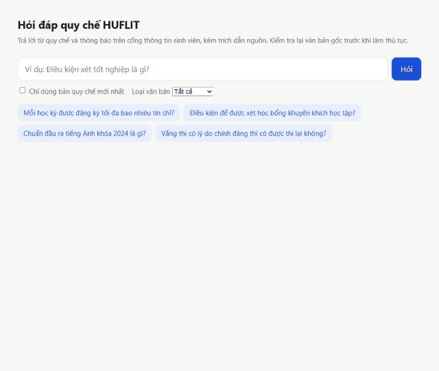
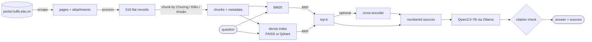

# HUFLIT Regulation QA

[](https://github.com/bebaobanhbaoo-create/vietnamese-qa-platform/actions/workflows/ci.yml)

Ask a question in Vietnamese about the academic regulations and announcements of HUFLIT (Ho Chi Minh City University of Foreign Languages – Information Technology); get an answer that cites the regulation articles it comes from, or an explicit "not found" when the sources do not say.

**[Live search demo](https://bebaobanhbaoo-create.github.io/vietnamese-qa-platform/)** — hybrid search running entirely in the browser. Cited answers need a local LLM; the recording below is from the full pipeline.



- **Data:** 434 portal pages and their attachments (PDF, scans), crawled, cleaned and split into 1,209 article-level passages; regulation versions dated from their headers.
- **Retrieval:** BM25 + multilingual embeddings fused with Reciprocal Rank Fusion, optional cross-encoder reranking, metadata filters (document type, issuing office, year, newest version), FAISS or Qdrant with incremental updates.
- **Answers:** a local LLM (Qwen2.5-7B through Ollama) answering only from numbered sources, with `[n]` citations checked automatically.
- **Evaluation:** pooled relevance labels, chunking-independent scoring, paired bootstrap confidence intervals, answer-level grounding and refusal metrics.
- **Data pipeline:** weekly Airflow DAG with incremental crawling, attachment download, a data-quality gate, evaluation regression check, automatic rollback and soft deletes ([docs/PIPELINE.md](docs/PIPELINE.md)).
- **Engineering:** typed package and CLI, FastAPI with streaming and Prometheus metrics, Docker, CI with unit, integration and container tests.

> Status: retrieval and RAG work end to end and are measured on 30 dev queries. The test set is being re-labelled (159 queries, pooled from four systems) before the final configuration is chosen and reported on the held-out split; see [docs/UPGRADE_PLAN.md](docs/UPGRADE_PLAN.md).

## Architecture



| Step | Command | Code |
|---|---|---|
| Scrape announcements, regulations and attachment links | `huflit-qa scrape` | `ingest/` |
| Extract PDF text, build one record per page or attachment | `huflit-qa extract-pdf`, `huflit-qa process` | `ingest/`, `processing/` |
| Chunk, build BM25 + dense index and its manifest | `huflit-qa index` | `processing/`, `indexing/` |
| Search, answer | `huflit-qa query`, `huflit-qa ask` | `retrieval/`, `generation/` |
| Evaluate retrieval, answers | `huflit-qa eval`, `huflit-qa eval-answers` | `evaluation/` |
| Serve API + chat page | `huflit-qa serve` | `api/` |

## Results so far

Retrieval, 30 dev queries of the original labels ([2B](eval/EXPERIMENTS_2B.md), [2C](eval/EXPERIMENTS_2C.md)):

| Configuration | nDCG@10 | MRR@10 | Hit@10 |
|---|---|---|---|
| Baseline: BM25 + MiniLM, original chunker | 0.605 | 0.635 | 0.833 |
| bge-m3 dense only, original chunker | 0.585 | 0.618 | 0.933 |
| bge-m3 + structure-aware chunker + bge-reranker-v2-m3 | **0.618** | **0.723** | 0.900 |

Answers with Qwen2.5-7B ([phase 3](eval/EXPERIMENTS_3.md)): every answer cites only sources it was shown or refuses; better retrieval removed false refusals (13.3% → 0%).

Two findings drive the next step. First, the original labels miss relevant passages that stronger models find: pooling from four systems surfaced 1,413 candidates (+48%) the first annotation never saw, which is why the test set is being re-labelled. Second, a cited answer can still be wrong: the baseline answered "maximum 14 credits" from a 2007 rule that sets 14 as the *minimum*. That is why answers are also reviewed by hand and why chunks carry issue dates and a newest-version flag.

## Design decisions

| Decision | Why |
|---|---|
| Exact FAISS search, Qdrant optional | ~10³ vectors: exact search is not the bottleneck (query encoding is); Qdrant returns the same neighbours and is there for filtering and incremental updates |
| Structure-aware chunks with a word budget | The original chunker produced chunks of up to 19,440 characters, mostly truncated by a 128-token encoder |
| Index manifest | The retriever searches with the tokenizer, model and casing the index was built with, so a model swap cannot silently corrupt results |
| Labels on frozen units, projected onto any chunking | Re-chunking would otherwise invalidate every label; all configurations are scored against the same relevant set |
| Pooled annotation from several systems | Labelling only what one system returns biases the test set towards it |
| Paired bootstrap on per-query nDCG | 30 dev queries are too few to read differences of a few points without an interval |
| Public demo as a static page | Free hosts no longer run Python containers; BM25 is ported to JavaScript (identical rankings on all 159 test queries) and queries are embedded in the browser with the ONNX build of the same model. 8-bit weights cost 0.014 nDCG@10 (0.621 → 0.607) for a 4× smaller download ([details](docs/DEMO.md)) |
| Local LLM, fixed refusal sentence, citation check | Runs offline on a 6 GB laptop GPU; refusals and citation errors are detectable without a judge model |

## Quickstart

```bash
python -m venv .venv
.venv/Scripts/activate        # Linux/macOS: source .venv/bin/activate
pip install -e ".[dev]"

huflit-qa query "điều kiện xét tốt nghiệp" -k 5
huflit-qa query "chuẩn đầu ra ngoại ngữ" --doc-type quy_che --newest-only --rerank BAAI/bge-reranker-v2-m3
huflit-qa eval
```

The repository ships with a prebuilt index; run `huflit-qa index` to rebuild it. Settings are documented in [.env.example](.env.example).

## Answering questions (RAG)

```bash
ollama pull qwen2.5:7b-instruct
huflit-qa ask "Mỗi học kỳ được đăng ký tối đa bao nhiêu tín chỉ?" --newest-only
huflit-qa eval-answers --split dev --output eval/results/answers_dev.json
```

The model must answer only from the numbered sources, cite them, prefer the newest version of a regulation and say a fixed sentence when the sources do not contain the answer. `eval-answers` scores grounding, citation precision against the relevance labels, and refusals (see [docs/EVALUATION.md](docs/EVALUATION.md)).

## API and chat page

```bash
huflit-qa serve --port 8080          # chat page at http://127.0.0.1:8080/, OpenAPI docs at /docs
```

| Endpoint | |
|---|---|
| `GET /health`, `GET /ready` | Liveness; readiness reports the loaded index, the mode (`rag` or `search`) and whether the LLM is reachable |
| `POST /v1/search` | Hybrid search with metadata filters (`doc_type`, `issuer_unit`, `year_from`, `newest_only`) |
| `POST /v1/ask` | Answer with numbered sources and a citation check (`grounded`, `refused`, invalid citations) |
| `POST /v1/ask/stream` | The same as server-sent events: `sources`, then `token`s, then `done` |
| `GET /metrics` | Prometheus request counts and latency histograms |

`HUFLIT_GENERATION__ENABLED=false` runs search only, as in the public demo. Every response carries an `x-request-id`; logs include it with the route, status and duration.

## Docker

```bash
docker compose up -d                                         # API + Ollama (GPU if available)
docker compose exec ollama ollama pull qwen2.5:7b-instruct   # once, ~4.7 GB
```

The API image is CPU-only (PyTorch CPU wheels), runs as a non-root user, ships the prebuilt index and the embedding model so it starts offline, and has a health check. Tagging `v*` publishes it to GitHub Container Registry. The static search demo is rebuilt and published to GitHub Pages when the index changes; `scripts/deploy_space.py` can deploy the Docker image to a Hugging Face Space (needs a PRO plan).

## Data

1,209 chunks from 516 documents (715 regulation, 494 announcement), posted between 07/2020 and 03/2026; see the [data card](docs/DATA_CARD.md). The documents belong to HUFLIT; they are public on the portal and used here for research. The full corpus is kept in a private Hugging Face dataset (`huflit-qa download-data`).

## Development

```bash
make check                 # ruff lint + format check, mypy, unit tests
pytest tests/integration   # end to end on a tiny corpus with the real embedding model
make format                # auto-fix lint and formatting
```

## License

MIT — see [LICENSE](LICENSE).
