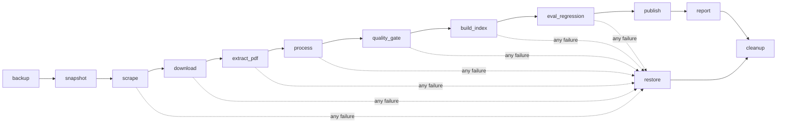

# Weekly ingestion pipeline (Airflow)

The corpus is refreshed every Monday at 02:00 (Asia/Ho_Chi_Minh) by the Airflow DAG [`huflit_weekly_ingest`](../deploy/airflow/dags/huflit_weekly_ingest.py).



| Step | What it does |
|---|---|
| `backup` | Copies `data/raw`, `data/processed`, `data/index` aside for this run |
| `snapshot` | Counts articles, records by type and status, duplicates, newest post (the "before" picture) |
| `scrape` | Lists every category; fetches detail pages only for new articles, failed ones, and ones whose "ngày cập nhật" changed. Merges by id, so re-runs never duplicate articles. Articles no longer listed are kept with `on_portal: false` |
| `download` | Fetches regulation attachments from SharePoint / Google Drive / direct links; rejects login pages (HTML instead of a file) |
| `extract_pdf` | Writes `.txt` next to new PDFs; never overwrites hand-corrected text |
| `process` | Rebuilds the flat records |
| `quality_gate` | Fails on duplicate ids, missing fields, malformed dates, > 10% fetch errors, > 25% empty records, or a document type shrinking by > 5% |
| `build_index` | Re-chunks, rebuilds BM25 and syncs Qdrant: only new or changed chunks are embedded, metadata-only changes rewrite the payload |
| `eval_regression` | Fails if hybrid nDCG@10 on the labelled queries drops > 0.05 below `eval/results/baseline.json` |
| `publish` | Uploads the corpus to the private Hugging Face dataset when `HF_TOKEN` is set |
| `report` | Writes `data/reports/ingest_<run_id>.json` with every step's summary |
| `restore` | Runs only if a step from `scrape` to `eval_regression` failed: puts the backup back |
| `cleanup` | Keeps the last four backups |

Every task runs `huflit-qa run-step <step> --run-id <run_id>` inside the project's own virtualenv in the Airflow image (the project's pinned ML stack would conflict with Airflow's own dependencies) and stores its summary in `data/.runs/<run_id>/<step>.json`. The steps live in [`huflit_qa/orchestration.py`](../src/huflit_qa/orchestration.py) and are unit-tested without Airflow; a CI job imports the DAG with Airflow 3.3.2 and checks its wiring.

## Running it

```bash
docker compose -f docker-compose.airflow.yml up -d --build      # Airflow UI on http://localhost:8088
docker compose -f docker-compose.airflow.yml exec airflow airflow dags trigger huflit_weekly_ingest
```

Without Airflow, the same steps run one by one: `huflit-qa run-step snapshot`, `huflit-qa run-step scrape`, …

## What the first live run caught

The first run against the live portal (2026-11-11) listed 590 articles, 156 of them new since the March crawl. The quality gate then **stopped the run**: regulation records had dropped from 24 to 11. Five regulations, including the training regulation (3208) and the language/IT exit requirements (3209), were no longer listed on the portal and their pages returned HTTP 403; the old raw crawl had never stored them, so rebuilding from raw would have silently removed the most-asked documents from the index.

The fix keeps documents that disappear from the portal (soft delete), flags them `on_portal: false`, backfills legacy articles that only existed in the processed files, and shows "đã gỡ khỏi portal" next to such sources in answers. The gate now reports them as a warning.
